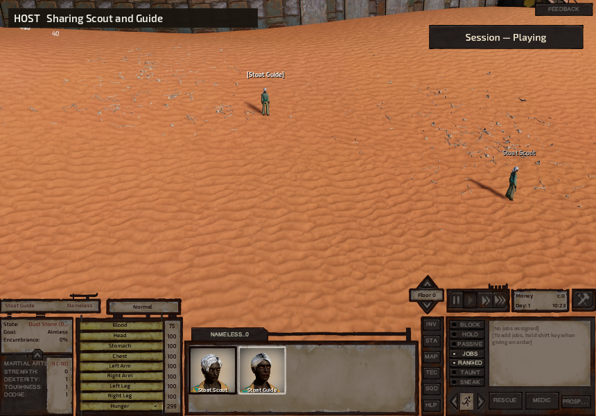

# Multiplayer-menu preview: local validation

Local test date: **22 November 2026**. Game: stock Windows Meitou **0.22.1**, build `9ee4074bbc6fd7fdeb26108a04afc9f90cb1dc01`. Packages: P2P and Co-op **0.2.0**, connector protocol **2**. The combined ZIP's `preview.json` records its exact source commit pair.

**The two-PC volunteer result is pending.** These checks used two visible clients on one Windows PC, first over loopback and then through a loopback fault proxy. They do not establish internet latency, Tailscale connectivity, or stability on the volunteer's machine.

## What passed locally

| Check | Observation |
| --- | --- |
| Native menu | Multiplayer, Host, address copy/paste, Join, Ready and Start loaded the fixed fixture through the stock new-game path. Character creation was skipped. Buildings and foliage remained enabled. |
| Compatibility and failures | Exact build, mode revision and changed-file refusals; occupied port; second guest rejected as Session full without displacing the first; unreachable host; cancelled handshake. |
| Readiness | Ready alone did not start the world. Slow guest preparation blocked play. A pending click and request were discarded on disconnect. Movement before renewed Ready was refused. |
| Native walk | Guest body selection, plain ground clicks, simultaneous Guide movement, guest pan-away and clear-selection, old-location miss, destination body reselection, and a second Scout move all passed. Guide-only and mixed guest orders were refused. |
| Independent views | Host retained Guide selection and the same camera pivot while the guest panned and selected Scout. |
| Recovery | Rejoin required Ready again, produced a different grant, and moved Scout successfully. Pose polling continued with the HUD hidden. |
| World replacement | Starting a different game in the guest stopped its trial and invalidated the host grant. The lobby regression also rejects a fresh guest attempting to reuse the suspended trial; start a fresh host session. |
| UI styles and size | Meitou and Faithful gameplay styles; 860-pixel client and maximized 1920-pixel client; native close button and restored window size. |
| Existing baseline | Connector-only handshake/ping/leave, combined host-resolved movement, stale grants, reconnect and replacement-world checks passed. The earlier loopback replay remains unchanged. |
| Player package | Clean sibling builds produced the combined ZIP. Its setup and launcher ran with neither the SDK nor Python on the player PATH, and that extracted package passed the native walk. The corrected log collector captured both running clients' complete log snapshots and version metadata; archived bytes matched the source files. |
| Cache location follow-up | Stock Windows PowerShell setup/launcher checks verified a saved cache directory, a one-run override, older-profile fallback, spaces and trailing separators, and both legacy clients using the same cache. Launch interception verified child-only environment changes without opening game windows. This launcher follow-up does not change movement or network code. |

## Walk evidence

The host is on the left and guest on the right in each pair. These are original captures, not a reconstruction. [Recorded camera, position, selection and tick samples](remote-preview/stages.json) cover the full walk; only selected images are curated here.

Guest pans away while Guide remains selected on the host:

| Host | Guest |
| --- | --- |
|  |  |

The old position misses:

| Host | Guest |
| --- | --- |
|  |  |

Scout is selected at her destination, with Guide still selected on the host:

| Host | Guest |
| --- | --- |
|  |  |

Scout arrived at `(34778.9, 966.9, -70158.0)`. The host camera pivot stayed at `(34665, 969.2, -70142)`. The second guest click moved Scout again. The test counted exactly two accepted guest orders and no host order for the subsequent Guide-only or mixed selections. [Refusal capture](remote-preview/25-guest.png) · [Fresh-grant result](remote-preview/reconnect.json) · [Faithful lobby at a larger size](remote-preview/faithful-maximized.png)

## Reproduce

Build both sibling repositories and prepare two isolated profiles using the combined ZIP's setup helper. Launch each with `-TestControl` for developer automation. Complete Host / Join / Ready / Start through the menu, then run the connector's `tools/stoat-native-walk.py <run-folder> --connected`, where the folder contains `host` and `guest` profiles. The driver sends actual screen-coordinate clicks through Meitou's input path and retains both clients' captures and query transcripts.

For recovery testing, run `tools/loopback-proxy.py <run-folder>/proxy`, host on `127.0.0.1:42871`, and join `127.0.0.1:42872`. After the walk, run `tools/stoat-reconnect.py <run-folder>`. The proxy can hold replies and drop its own connections without changing system networking. It is a developer test tool and is excluded from the player ZIP.

Run `dotnet run --project tools/SessionChecks -c Release` for transport/lobby failure checks, and `python tools/smoke.py` for the released loader and simulation regressions. These require the developer SDK/build setup documented in the connector README. Player setup does not.

## Observed limitations

The isolated profile uses the stock static title because the animated title stalled during this local test. Several explicit background-window activations by the Windows automation helper were followed by a native `GLFW.PollEvents` access violation. The cause is unresolved. Keeping the guest foreground and using Meitou's built-in coordinate-click test channel allowed the checks above to complete. Manual window switching and the actual remote volunteer session still need broader stability testing.

Only Scout and Guide's poses and guest movement requests are shared. NPCs, combat, inventory and campaign simulation remain independent. Loading another world requires a fresh host trial. Follow the separate [volunteer acceptance checklist](remote-playtest.md) and collect both PCs' logs before recording a remote pass.

The [gameplay-footage notice](../LICENSING.md#stoat-replay) applies to these captures; they are excluded from the CC0 dedication for original guides and fixtures.
